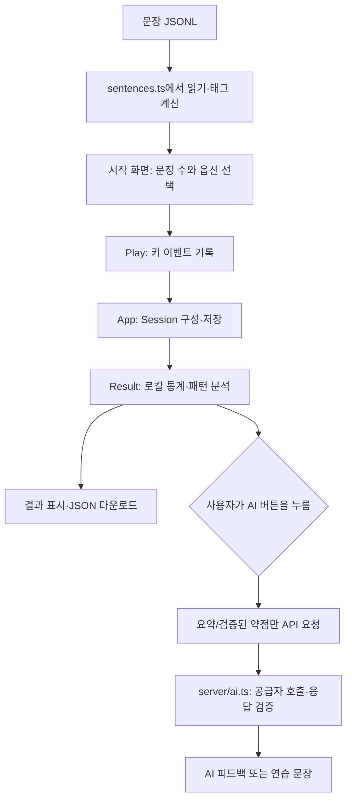

# 타자 코치 프로젝트 구조와 기능 안내

- 작성일: 2026-11-23
- 기준 버전: `0.1.19`
- 목적: 처음 프로젝트를 열었을 때 각 폴더의 역할, 화면 기능이 연결되는 코드, 데이터가 저장·분석·AI로 전달되는 경로를 찾기 위한 안내서입니다.

## 1. 프로젝트 한눈에 보기

이 프로젝트는 React와 TypeScript로 만든 타자 연습 앱입니다. Electron을 사용해 Windows 데스크톱 설치 파일로 배포하고, Vite 개발 서버를 통해 브라우저에서도 실행할 수 있습니다.

사용자는 문장을 입력하고, 앱은 키를 누른 시각과 키 종류, 정답 여부, 수정 동작 등을 세션 기록으로 저장합니다. 결과 화면은 이 기록을 로컬에서 분석해 속도·정확도·키별 오류·입력 패턴을 보여 줍니다. 사용자가 요청할 때만 요약 정보를 AI 서버 코드에 보내 피드백을 받거나 연습 문장을 생성합니다.

현재 기본 설정에서는 문장별 AI 분석과 질문 카드가 켜져 있습니다. 문장 분석을 시작할 때 메인 프로세스가 반환한 기능 설정, 전송 동의, Gemini 키를 각각 확인하고 누락된 조건만 안내합니다. 문장 분석·질문 카드 설정, 동의 상태와 동의 시각은 별도로 저장합니다. 일반 연습, 결과 화면의 알고리즘 분석, AI 피드백, AI 연습 문장 생성은 별도 기능입니다.

## 2. 최상위 폴더와 주요 파일

```text
Gwaze/
├─ index.html                 브라우저 앱 HTML 진입 문서
├─ package.json               버전, 명령, 의존성, Electron 배포 설정
├─ package-lock.json          설치 의존성의 잠금 목록
├─ vite.config.ts             Vite 설정과 개발용 /api 연결
├─ tsconfig.json              TypeScript 컴파일 검사 설정
├─ vitest.config.ts           Vitest 테스트 설정
├─ config/                    앱 기능 플래그와 분석 기준값
├─ data/sentences/            연습 문장 원본(JSON Lines)
├─ desktop/                   Electron 메인 프로세스와 preload
├─ server/                    AI 피드백·연습 문장 API 처리
├─ shared/                    브라우저와 서버에서 같이 쓰는 규칙
├─ src/                       React 화면과 핵심 앱 로직
├─ tools/                     문장 데이터 점검·분석을 위한 Python 도구
├─ 검증/                      수치 검증 자료와 샘플 세션
├─ 기획서/                    프로젝트 기획 문서
├─ 백업_20261123/              날짜가 붙은 이전 소스 백업
├─ 백업_20261123_2/            0.1.18 AI 기능 재작업 전 소스 백업
├─ 백업_20261123_3/            결과 화면·누적 개편 전 소스 백업
├─ archive/legacy-web/         이전 웹 구현 보관본
└─ release/                    Windows 설치 파일과 배포 산출물
   └─ legacy/                 이전 버전 설치 파일·blockmap 보관
```

`node_modules/`, `dist/`, `desktop-dist/`, `release/win-unpacked/`는 의존성 또는 빌드 과정에서 만들어지는 폴더입니다. 일반적으로 앱의 기준 소스는 `src/`, `server/`, `desktop/`, `shared/`, `config/`, `data/`에 있습니다.

## 3. 실제 실행 흐름



### 시작부터 결과까지

1. `src/main.tsx`가 React 앱을 올리고 `src/App.tsx`가 화면 상태를 관리합니다. 화면 상태는 `start`, `play`, `result` 세 종류입니다.
2. `src/lib/sentences.ts`가 `data/sentences/*.jsonl`을 빌드 시 읽어 문장 목록을 만듭니다. 태그는 저장된 필드가 아니라 문장 텍스트에서 계산합니다.
3. `src/components/Start.tsx`에서 다음 키 힌트, 손목 위치, 키보드 높이 차이를 설정합니다. 데스크톱 앱에서는 10·20·30문장 중 하나를 고를 수 있고, 이전 사용량이 적은 문장을 우선 선택합니다.
4. `src/components/Play.tsx`가 키보드 이벤트를 받고 문장별 `RoundRecord`를 만듭니다. 데스크톱 앱에서는 일시정지와 재개도 기록합니다.
5. 마지막 문장을 마치면 `src/App.tsx`가 `Session`을 만들고, `src/lib/stats.ts`의 분석 결과에서 정확도 필드를 계산해 추가한 뒤 저장합니다.
6. `src/components/Result.tsx`가 같은 세션을 다시 분석해 결과 화면을 만듭니다. 결과 화면에서 AI 요청은 자동으로 실행되지 않습니다.

## 4. 화면별 코드와 기능

### 시작 화면 — `src/components/Start.tsx`

- 다음 입력 키를 화면 키보드에 표시하는 옵션을 제공합니다.
- 데스크톱 앱에서 10·20·30문장 코스를 선택합니다.
- 이전 기록의 문장 사용 횟수를 집계해 덜 사용한 문장을 우선합니다. 선택 문장의 총 길이는 평균 기준 ±30% 범위를 목표로 하며, 제한 횟수 안에 구성을 찾지 못하면 가장 가까운 구성을 씁니다.
- 길이 기준을 통과하지 못한 문장은 연습 선택에서 제외합니다.
- `WristSetup`으로 왼손·오른손 손목 기준점을 설정하고 손목과 키보드 높이 차이(mm)를 저장합니다.
- Electron에서는 Gemini 또는 Multi AI 제공자·모델·키를 설정합니다. 저장된 키 유무도 화면에 표시합니다.
- 마지막 8개 기록을 눌러 과거 결과를 다시 볼 수 있습니다.

### 연습 화면 — `src/components/Play.tsx`

- 문장에 필요한 입력 순서를 `src/lib/keyboard.ts`에서 얻고, 현재 입력 위치와 다음 키 힌트를 표시합니다.
- 키다운·키업 시각, 물리 키 코드, Shift/Caps Lock 상태, 정답 문자, 실제 입력, 입력 오류, 위치 정보 등을 `KeyEvent`에 기록합니다.
- 한글 IME(Process, 조합 상태, 과거 keyCode 229 등)의 신호를 같이 기록해 한/영 오류를 해석하는 데 사용합니다.
- Backspace 입력은 앞선 문자를 제거하는 동작과 연결해, 지운 입력이 정타였는지 필요한 입력이었는지 기록할 수 있습니다.
- Caps Lock 키 누름 자체는 modifier 이벤트입니다. 대소문자가 목표와 다르게 입력된 문자는 오류로 분류될 수 있지만, modifier 이벤트 자체를 문자 오타로 세지 않습니다.
- Electron에서 일시정지한 동안 키 입력은 무시합니다. 정지 구간, 재개 후 첫 입력 지연도 기록합니다.
- 문장을 마칠 때 Enter로 다음 라운드로 넘어가며, 각 문장의 이벤트는 해당 라운드에 보관됩니다.

### 결과 화면 — `src/components/Result.tsx`

- 전체 속도·정확도·첫 입력 대기 시간, 약점 요약, 라운드별 속도 막대, 키보드 오류·속도 지도, Shift 조합, 자주 틀린 키를 보여 줍니다.
- 입력 패턴 감지, 손가락·한글 위치·받침별 오류, 한/영 상태 오류, 입력 간격, 수정 기록, 일시정지 분석도 보여 줍니다.
- 이전 연습과 비교할 수 있는 경우에는 키별 오류율과 신뢰구간을 비교합니다.
- AI 피드백과 약점 연습 문장 생성은 버튼을 눌렀을 때 요청합니다. 처리 중 안내와 오류 메시지는 같은 화면에 표시됩니다.
- `AI에 보낼 요약 데이터`를 펼쳐 요청에 사용하는 요약을 확인하고 복사할 수 있습니다.
- `기록 내려받기`는 JSON을 만듭니다. 기존 세션 필드와 함께 `rawData.rounds`에 모든 라운드와 원시 키 이벤트를 넣습니다. 세션 원본의 `rounds[].events`에도 원시 이벤트가 들어 있어 `rawData`는 분석 도구에서 찾기 쉽도록 별도로 반복한 부분입니다.
- 문장별 분석 영역은 기능이 꺼져 있어도 표시되어 막힌 조건을 알립니다. 분석 버튼은 Gemini 키, 동의, 기능 사용 여부를 따로 검사하며, 실패 조건별 안내와 재시도를 제공합니다. 분석에 성공하면 질문 카드를 피드백보다 먼저 보여 주고 답변을 선택 또는 건너뛸 수 있습니다.

### 보조 컴포넌트

- `src/components/Keyboard.tsx`: 키보드의 물리 배치, 다음 키 표시, 오류·속도 히트맵을 렌더링합니다.
- `src/components/WristSetup.tsx`: 양손 손목 기준점을 마우스로 조절합니다.
- `src/styles.css`: 시작·연습·결과 화면 및 공통 UI 스타일을 정의합니다.

## 5. 주요 데이터 형식

### 문장 원본 — `data/sentences/*.jsonl`

한 줄에 JSON 객체 하나를 저장하는 JSON Lines 형식입니다.

```json
{"id":"quote_001","category":"quote","text":"어제의 실패를 오늘의 가능성으로 바꾸는 힘은 다시 시작하는 용기에서 나온다."}
```

각 레코드의 기본 필드는 `id`, `category`, `text`입니다. 실행 중 `tags`가 계산됩니다. 허용 문자, 문장 길이, ID 순서 등은 `tools/check_sentences.py`와 `shared/rules.ts`에서 점검합니다.

### 세션 — `src/lib/types.ts`

- `Session`: 세션 ID·시각·키보드 종류·연습 모드·옵션·정확도·일시정지 목록·라운드를 포함하는 최상위 기록입니다.
- `RoundRecord`: 문장 ID, 실제 연습 문장, 태그, 키 이벤트 배열을 가집니다.
- `KeyEvent`: 키다운 시각 `t`, 키업 시각 `keyupT`, 물리 키 코드 `code`, 이벤트 종류 `kind`, 입력 위치 `pos`, 정답·실제 입력 문자, 오류 종류, Shift/IME 상태, 수정 여부 등을 가질 수 있습니다. 이전 버전 기록에는 일부 필드가 없을 수 있습니다.
- `PauseInterval`: 세션 기준 일시정지 시작·종료 시각을 저장합니다.
- `Feedback`: AI 총평, 강점, 약점, 관찰 항목, 기타 의견, 다음 연습을 담습니다.

`src/lib/sessionData.ts`는 저장된 이전 세션을 읽을 때 빠진 `roundCount`, `pauses`, 피드백 필드를 기본값으로 정리합니다. 데스크톱에서 새로 저장하는 세션은 `schemaVersion: 4`를 가집니다.

### 브라우저 저장

`src/lib/storage.ts`가 `localStorage`의 `typing-coach-sessions-v1` 키에 세션 목록을 저장합니다. 최근 세션 최대 8개를 유지합니다. 저장 용량 부족 시 가장 오래된 항목을 잘라 재시도합니다. 별도 서버 데이터베이스는 사용하지 않습니다.

## 6. 분석 기능의 위치와 기준

### 핵심 집계 — `src/lib/stats.ts`

`analyze(session)`이 결과 화면에 필요한 집계 객체를 만듭니다.

- 분당 타수·분당 문자 수, 정확도, 총 오입력, Backspace 수, 첫 입력까지 걸린 시간, 라운드별 시간·속도
- 키별 입력 수·오입력 수·오류율·Wilson 95% 신뢰구간
- 키 사이 입력 간격, 느린 키, 같은 손·교대 손 입력 간격
- 목표 키와 실제 키의 오입력 조합, 키 간 거리·방향, 왼손·오른손 방향 통계
- 수정까지 걸린 시간과 수정 후 같은 위치에서 다시 틀린 횟수
- 문장 태그별 속도·오류율, 느린 어절, 입력 간격 분포

키별 약점 계산에서는 연쇄 오입력을 첫 오류에 중복 귀속하지 않습니다. 표본 수가 너무 적으면 키별 오류 관찰에서 제외합니다. 현재 기본 기준은 키별 최소 표본 5회, 중간 확신도 최소 표본 15회, 높은 확신도 최소 표본 30회입니다. 확신도는 Wilson 구간의 하한이 세션 전체 오류율보다 높은지도 함께 봅니다.

정확도는 두 종류가 있습니다. `accuracyA`는 문자 입력 시도에서 발생한 오류를 기준으로 합니다. `accuracyB`는 원래 맞게 입력한 문자를 불필요하게 지운 기록까지 반영합니다. 이전 세션에 지우기 상세 정보가 없어 계산할 수 없으면 `accuracyB`는 집계하지 않습니다.

### 추가 패턴 감지 — `src/lib/detection.ts`

- 입력과 목표 키 시퀀스를 정렬해 치환·누락·초과·자리 바뀜을 분류합니다. 정렬이 모호하면 모호 상태로 표시합니다.
- 공백 오류, 입력 키 중복, 키가 겹쳐 눌린 이벤트, Shift 해제 시각, 한/영 입력 상태 신호를 분석합니다.
- 오류 직후 후속 입력 간격이 기준보다 느려지는지, 지정 시간 안에 오류가 연속되는지 관찰합니다. 표본 수가 부족하면 연쇄 진단을 내지 않습니다.
- 오류를 수정하기 전까지 이어진 입력 길이, 짧은 문장에서의 성급한 입력 관찰을 계산합니다.
- 손목 기준점과 높이 차이를 사용해 키 도달 거리를 세 구간으로 나누고, 손가락·한글 초성/중성/종성·받침별 오류율을 집계합니다.
- 누락 키업 시각 등 필요한 이벤트 자료가 없는 구간은 집계 불가로 표시합니다.

여러 임계값은 `config/thresholds.json`에 있습니다. 예를 들어 입력 중복 시간 50ms, 오타 후 감속 기준 1.3배, 후속 키 5개, 2초 초과 입력 간격 표시, 여러 세션 기준선 3회 등이 이 파일에서 관리됩니다.

### AI용 사실 목록 — `src/lib/facts.ts`

`buildFactList()`는 전체 오류율과 키별 오류율뿐 아니라 느린 키 상위 5개·느린 어절 상위 5개, 한글 초성·중성·종성 및 받침 유무, 손가락별 오류, 검증된 뻗음 3분위, 같은 손·번갈아 입력 간격, 공백 오류, 한/영 상태 오류와 수정 수, Shift 조합 오류, 수정 시간·재오타·미수정 연속 입력, 일시정지 정보를 `F01` 같은 ID가 있는 사실 객체로 만듭니다. 사실마다 `id`, `label`, `k`, `n`, `rate`, `ci`, `basis`가 있으며 표본 5회 미만인 사실은 코드 확신도를 부여하지 않습니다. 금지 지표인 직전 키 반복 비율, 평균 방향 `meanDx`, 고정 2칸 구간은 넣지 않습니다. 이 계층은 원시 키 이벤트를 받지 않습니다.

## 7. AI 기능과 요청 경로

### 프런트엔드 — `src/lib/ai.ts`

- `requestFeedback()`은 피드백 API를 호출하고 반환된 객체를 화면에서 쓸 `Feedback` 형식으로 정규화합니다.
- `requestPractice()`는 확신도 기준에 미달하는 약점 정보를 걸러내고 연습 문장 API를 호출합니다.
- `requestSentenceAnalysis()`는 선별된 문장 통계만 전송합니다. 결과를 클라이언트에서도 다시 검증하고 질문은 세션 전체 5개로 제한합니다.
- Electron에서는 `window.typingCoach.request()` IPC를 사용합니다. 브라우저 개발 실행에서는 `/api/feedback`, `/api/practice` HTTP 요청을 사용합니다.

### 서버 로직 — `server/ai.ts`

- `/api/feedback`: 집계된 `facts`와 코드에서 계산한 기준선 충족 여부를 입력으로 구성합니다. 원시 이벤트, 일부 추정 경향 값은 피드백 모델 요청에서 제거합니다. F01은 전체 오입력의 k/n/rate를 포함합니다. 응답의 사실 ID, 숫자 자리표시자, 단위, 메타 문구, 조언의 근거 조건을 검증하며, 모델 총평이 비거나 검증에서 제외되면 F01에서 코드가 총평 문장을 생성해 형식 오류로 끝나지 않게 합니다.
- `/api/sentence-analysis`: 선별된 문장 텍스트 및 집계만 받습니다. 응답의 kind, 라운드 ID, 자리표시자 밖 숫자, 건강 관련 표현, 질문 `checkMethod`와 개수를 검사합니다.
- `/api/practice`: 전달받은 요약에서 검증 가능한 약점 키를 추려 연습 문장 생성 모델을 호출합니다. 결과 문장은 문자·길이·중복·총 글자 수 조건을 검사하고, 조건을 만족하는 문장만 반환합니다.
- `handleApi()`: 요청 크기, 경로, 공급자 오류를 처리하고 HTTP 상태와 JSON 응답을 만듭니다.
- 일반 Gemini 요청은 429에서 재시도하지 않습니다. 라운드 문장 분석은 `gemini-3.8-flash` → `gemini-3.6-flash` → `gemini-3.5-flash-lite` 순으로 다음 모델을 시도하고, 실제 사용 모델을 결과와 저장 기록에 표시합니다. 세 모델이 모두 한도에 걸리면 `Gemini 사용 한도에 도달했어요. 나중에 다시 시도해 주세요`를 돌려줍니다.

### AI 설정 — Electron

- `desktop/main.ts`: Electron 창, API 키 설정·삭제, IPC 핸들러, 로컬 AI API 호출을 관리합니다. API 키는 Electron `safeStorage`로 암호화하고, AI 기능 설정과 JSONL 기록을 사용자 데이터 폴더에 저장합니다.
- `desktop/sessionStore.ts`: `sessions.jsonl`을 임시 파일에 쓴 뒤 이름을 바꿔 갱신합니다. 초기 `analysis`, `raw` 행 다음에 `ai_analysis`, `answers`, `feedback`, `note_answer` 행을 이어 붙이고, Electron 기록과 localStorage 기록을 함께 목록에 표시합니다.
- `desktop/featureSettings.ts`: 문장 분석 사용, 질문 카드 사용, 전송 동의와 동의 시각을 읽고 저장합니다. 세션 기록과 동일한 원자적 파일 쓰기 유틸을 사용합니다.
- `desktop/preload.cjs`: 필요한 API만 제한적으로 브라우저 화면에 공개합니다. `contextIsolation`이 켜져 있고 `nodeIntegration`은 꺼져 있습니다.
- `src/electron.d.ts`: `window.typingCoach` API의 TypeScript 형식입니다.
- `shared/aiModels.ts`: Gemini와 Multi AI에서 선택할 수 있는 모델 목록과 공급자 검사를 둡니다.
- 개발 환경은 `.env`의 `GEMINI_API_KEY`, `GEMINI_MODEL`, `AI_PROVIDER`, `AI_MODEL`, `MULTI_AI_API_KEY` 값을 읽을 수 있습니다. 실제 비밀 키를 문서나 코드 저장소에 넣지 않습니다.

### 문장 분석과 질문 카드 — `src/lib/sentenceAnalysis.ts`

세션 결과에서 10라운드 단위로 오타율 2% 이상·첫 오입력 에피소드 2개 이상인 라운드를 최대 3개 고릅니다. 분석 버튼은 Gemini 키, 전송 동의, 기능 사용 상태를 각각 검사해 해당 안내만 표시합니다. 동의가 없으면 허용 창을 열고, 조건이 모두 충족되면 바로 분석을 시작합니다. 최대 5개씩 두 번 Gemini를 호출하며 혼잡·한도·모델 오류 때 3.8 → 3.6 → 3.5 Flash-Lite 순으로 폴백합니다. 사용 모델을 분석 결과에 기록하고 화면에도 표시합니다. 질문은 라운드당 2개·세션당 5개까지 표시하고 답변을 건너뛸 수 있습니다. 질문 문장과 이유 다음에 답변 버튼을 놓고 확인 방법을 보여 줍니다. `아니에요`는 피드백 AI가 해당 주제를 약점으로 제안하지 않게 전달하며 답변은 코드 확신도 계산에 사용하지 않습니다.

### 세션 저장

Electron 기록은 사용자 데이터 폴더의 `sessions.jsonl`에 저장합니다. `analysis`, `raw` 다음에 분석 결과, 답변, 피드백, 기타 제언 답변을 별도 행으로 붙입니다. localStorage 기록은 삭제·변환하지 않고 Electron 기록과 목록에서 합쳐 보이며, localStorage 전용 세션은 문장 분석 대상으로 보내지 않습니다.

## 8. Electron·브라우저 차이

| 항목 | 브라우저 개발 실행 | Windows Electron 앱 |
|---|---|---|
| 시작 방식 | Vite 개발 서버 | Electron이 `dist/index.html` 로드 |
| 연습 문장 수 | 문장 데이터 기준 기본 코스 | 10·20·30문장 선택 |
| AI 키 설정 UI | 없음 | 제공자·모델·키 설정 가능 |
| AI 요청 | Vite 개발 미들웨어 `/api` | preload IPC에서 `server/ai.ts` 직접 호출 |
| 키 보관 | 개발 환경 변수 사용 가능 | Windows 사용자 데이터에서 암호화 보관 |
| 일시정지 | 화면 버튼 숨김 | 일시정지·재개 이벤트 지원 |

Vite 개발 API 미들웨어는 `vite.config.ts`에 있습니다. 운영 Windows 설치 파일은 별도 웹 서버를 띄우지 않고 Electron 메인 프로세스가 `server/ai.ts`의 API 함수를 호출합니다.

## 9. 데이터·문장 관리 도구

- `tools/check_sentences.py`: JSONL 문장 필드, ID 형식·순서, 중복 ID, 허용 문자, 문장 길이, 특정 파일 외 줄바꿈을 검사합니다.
- `tools/tag_sentences.py`: 문장별 태그 계산이 가능한지 확인합니다. 태그는 JSONL에 기록하지 않고 앱 실행 시 계산합니다.
- `tools/make_round.py`: 문장 풀에서 지정 수의 문장을 뽑아 총 글자 수가 평균 기준 ±30%에 드는 연습 세트를 만듭니다.
- `tools/features.py`: 문장 길이, 어절 수, 받침·복합 모음·쌍자음, 숫자·영문·기호 등의 문장 특성을 계산합니다.
- `tools/summary.py`: `features.py`를 이용해 문장 특성의 최소·중앙값·최대·평균과 구간별 분포를 출력합니다.
- `shared/rules.ts`: 앱과 서버가 공유하는 문장 유효성·태그 계산 규칙을 둡니다.
- `src/lib/hangul.ts`: 한글 키 입력의 자모 조합과 입력 표시를 계산합니다.
- `src/lib/keyboard.ts`: QWERTY·두벌식 키 배치, 문자에서 키 시퀀스로의 변환, 손·손가락 분류, 손목 설정을 관리합니다.

## 10. 테스트와 개발·배포 명령

`src/lib/*.test.ts`는 통계·감지·세션 저장 규칙·문장 처리 등의 테스트입니다. `server/*.test.ts`는 AI 요청 필터링, 응답 검증, 모델 선택과 서버 동작을 확인합니다. `vitest.config.ts`가 테스트 실행 환경을 설정합니다.

```powershell
npm run dev          # Vite 개발 서버 (기본 포트 5173)
npm test             # Vitest 전체 테스트
npx tsc --noEmit     # TypeScript 형식·타입 검사
npm run build        # 브라우저 배포용 dist 생성
npm run desktop:dev  # 데스크톱 코드 빌드 후 Electron 실행
npm run dist:win     # Windows NSIS 설치 파일 생성
```

`npm run dist:win`은 웹 빌드, Electron 메인 코드 번들, Windows 설치 패키징을 순서대로 실행합니다. 결과는 `release/`에 생성됩니다. 현재 빌드 설정은 `AI 타자 코치 Setup <버전>.exe` 형식을 사용합니다. 코드 서명 인증서는 설정되어 있지 않습니다.

## 11. 테스트·백업·릴리스 폴더 읽는 법

- `검증/`: 수치 대조 메모와 테스트용 세션 JSON을 보관합니다. 앱 실행 시 자동으로 읽는 경로는 아닙니다.
- `작업보고_20261123.md`: 수치 비교, 구현 변경, 테스트 결과, 남은 직접 확인 항목을 적은 작업 보고서입니다.
- `기획서/기획서.md`: 제품 기획 문서입니다.
- `백업_20261123/`: 현재 기준 소스와 과거 소스를 대조하기 위해 만든 날짜별 백업입니다. 실행 빌드의 입력으로 사용되지 않습니다.
- `백업_20261123_3/`: 0.1.19 결과 화면과 누적 약점 판정 변경 전의 `src/`, `server/`, `shared/`, `config/`, `desktop/` 사본입니다.
- `archive/legacy-web/`: 이전 웹 버전의 보관본입니다. 현재 앱 소스는 저장소 루트의 `src/`입니다.
- `release/legacy/`: 이전 설치 파일과 blockmap 보관 위치입니다. 사용자가 받을 최신 설치 파일은 `release/AI 타자 코치 Setup 0.1.19.exe`입니다.
- `release/latest.yml`: 최신 버전 번호, 설치 파일 이름, 크기, SHA512, 배포 시각을 기록한 electron-builder 메타데이터입니다.
- `.env.example`: 개발용 환경 변수 이름의 예시입니다. 실제 `.env` 파일은 `.gitignore` 대상입니다.

## 12. 유지보수할 때 먼저 볼 파일

| 바꾸려는 것 | 먼저 볼 파일 |
|---|---|
| 화면 전환·세션 생성 | `src/App.tsx` |
| 시작 옵션·문장 수·AI 키 설정 | `src/components/Start.tsx` |
| 키 입력 기록·일시정지 | `src/components/Play.tsx` |
| 결과 항목·내려받기 | `src/components/Result.tsx` |
| 집계식·약점·신뢰구간 | `src/lib/stats.ts`, `src/lib/facts.ts` |

## 13. 0.1.19 결과 화면과 누적 약점 판정

결과 화면은 한 줄 요약, 약점 카드, 지켜볼 것, AI 질문, 접힌 상세 분석, AI 기타 제언 순서입니다. 약점 카드는 근거, 가능한 원인 두 가지, 확인 방법과 오늘 연습을 보여 주며 맞아요/아니에요 버튼은 두지 않습니다. 답변 버튼은 AI 질문 카드에서만 사용합니다. 기술 용어는 보조 설명 툴팁에서만 사용합니다.

약점 카드는 같은 힌트 설정의 최근 세션 3개를 합쳐 판단합니다. 근거에는 “최근 3번 합산 기준 N번 입력 중 M번 오타”를 표시하고, 신뢰도 문구도 같은 누적 기준을 설명합니다. 키별 표와 카드가 같은 코드 확신도 라벨을 씁니다. 기준 세션이 세 개 미만이면 카드를 만들지 않고 추가 연습 횟수를 안내합니다. 기존 브라우저 기록은 목록에 남고, Electron 세션 파일과 구분해 AI 전송에서 제외합니다.

문장별 AI 질문과 답변은 화면에서 세션에 이어 붙여 저장합니다. 질문 답변은 건너뛸 수 있고, 서로 다른 문장의 질문 ID가 겹치지 않도록 문장 ID를 포함합니다. AI가 검증되지 않은 질문임을 화면에 표시합니다.
| 입력 패턴 판정·기준선 | `src/lib/detection.ts`, `config/thresholds.json` |
| 문장 목록·선택 | `data/sentences/`, `src/lib/sentences.ts`, `src/lib/roundSelection.ts` |
| AI 요청 형식·응답 검증 | `src/lib/ai.ts`, `server/ai.ts`, `shared/aiModels.ts` |
| 키 저장·Electron 보안 경계 | `desktop/main.ts`, `desktop/preload.cjs`, `src/electron.d.ts` |
| 문장별 AI·질문 카드 사용 여부 | `config/aiFeatures.json` |
| 창·앱 패키징·설치 파일 | `package.json`, `vite.config.ts` |

